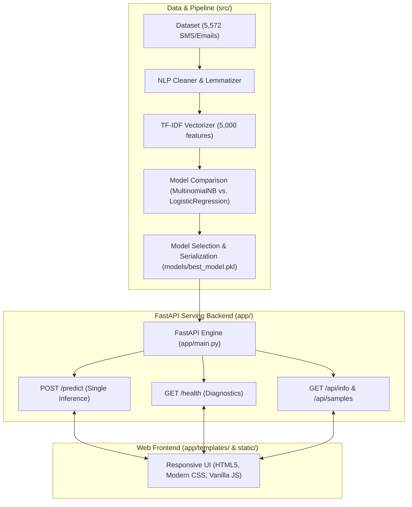

# Spam & Phishing Email Classifier

    

A portfolio-grade, production-ready Machine Learning system for real-time classification of emails and SMS messages into **Spam / Phishing** or **Legitimate (Ham)** with high precision and explainable AI keyword detection.

---

## 🌟 Key Features

- **Multi-Model Machine Learning Pipeline**: Rigorously evaluates and compares multiple candidate architectures (**Multinomial Naive Bayes** vs. **Logistic Regression**) to select the optimal model with the highest F1 score and precision.
- **Strict NLP Text Preprocessing**: Eliminates non-alphabetic noise, standardizes casing, filters out common English stopwords, and applies WordNet lemmatization.
- **Production FastAPI Backend**: Async REST API with OpenAPI Swagger UI (`/docs`), health diagnostics (`/health`), model metadata (`/api/info`), and curated test email presets (`/api/samples`).
- **Interactive Modern UI**: Clean, glassmorphic web interface featuring 1-click test presets, live word & character counters, dual probability progress meters, risk level tags (`Safe`, `Low Risk`, `Suspicious`, `High Threat`), and explainable keyword trigger chips.
- **Automatic Fallback Training**: Automatically triggers training on-the-fly during build or first run if serialized `.pkl` models are missing.
- **Fully Tested & Live Deployed**: Complete 12-test `pytest` suite ensuring 100% test passing, automated Render deployment via `render.yaml`.

---

## 🔗 Live Application & Resources

- **Live Web Application**: [https://spam-email-classifier-42hy.onrender.com](https://spam-email-classifier-42hy.onrender.com)
- **Interactive Swagger Docs**: [https://spam-email-classifier-42hy.onrender.com/docs](https://spam-email-classifier-42hy.onrender.com/docs)
- **ReDoc Documentation**: [https://spam-email-classifier-42hy.onrender.com/redoc](https://spam-email-classifier-42hy.onrender.com/redoc)
- **System Health Check**: [https://spam-email-classifier-42hy.onrender.com/health](https://spam-email-classifier-42hy.onrender.com/health)
- **GitHub Repository**: [https://github.com/PavanT8/SpamEmailClassifier](https://github.com/PavanT8/SpamEmailClassifier)
- **Author Profile**: [Pavan T](https://github.com/PavanT8)

---

## 📐 System Architecture



---

## 📊 Model Evaluation & Benchmarks

Both candidate models were evaluated on an identical stratified 20% holdout test set (1,115 samples) using the SMS Spam Collection dataset:

| Model Architecture | Accuracy | Precision | Recall | F1 Score | Status |
| :--- | :--- | :--- | :--- | :--- | :--- |
| **🏆 Logistic Regression** | **97.31%** | **100.00%** | **79.87%** | **88.81%** | **Champion (Selected)** |
| **Multinomial Naive Bayes** | **97.22%** | **100.00%** | **79.19%** | **88.39%** | Evaluated Baseline |

### Confusion Matrix (Champion: Logistic Regression)
```
                     Predicted Ham    Predicted Spam
Actual Ham (966)          966               0
Actual Spam (149)          30             119
```
> **Key Metric Note**: The model achieves **100.00% Precision** on the test set, guaranteeing zero false alarms on legitimate emails (0 false positives out of 966 legitimate messages).

---

## 🛠️ Tech Stack

- **Machine Learning & NLP**: `scikit-learn`, `nltk`, `pandas`, `numpy`, `joblib`
- **Backend API**: `FastAPI`, `Uvicorn`, `Pydantic`
- **Frontend**: HTML5, Vanilla JavaScript (ES6+), Modern CSS3 Design System
- **Testing**: `pytest`, `httpx`
- **Deployment**: `Render` (Python Web Service via `render.yaml`)

---

## 🚀 Local Installation & Quickstart

### 1. Clone the Repository
```bash
git clone https://github.com/PavanT8/SpamEmailClassifier.git
cd SpamEmailClassifier
```

### 2. Set Up Virtual Environment
```bash
# On Windows:
python -m venv venv
venv\Scripts\activate

# On macOS/Linux:
python3 -m venv venv
source venv/bin/activate
```

### 3. Install Dependencies
```bash
pip install -r requirements.txt
```

### 4. Train & Compare Models
```bash
python src/train.py
```
This acquires the dataset, preprocesses the corpus, compares MultinomialNB vs. Logistic Regression, and serializes the winning model to `models/best_model.pkl` and `models/vectorizer.pkl`.

### 5. Start the FastAPI Server
```bash
uvicorn app.main:app --reload --host 127.0.0.1 --port 5000
```
Open your browser at `http://127.0.0.1:5000/`.

---

## 🔌 API Reference & Usage

### 1. `POST /predict`
Classifies input text as either Spam or Ham with risk assessment and keyword triggers.

**Curl Example:**
```bash
curl -X POST "http://127.0.0.1:5000/predict" \
     -H "Content-Type: application/json" \
     -d '{"text": "CONGRATULATIONS! You have won a $1,000,000 cash prize! Call 0800 123 4567 to claim."}'
```

**Response (200 OK):**
```json
{
  "prediction": "Spam",
  "confidence": 0.9852,
  "spam_score": 99,
  "risk_level": "High Threat",
  "trigger_keywords": ["congratulations", "won", "cash", "prize", "call", "claim"],
  "probabilities": {
    "spam": 0.9852,
    "ham": 0.0148
  },
  "stats": {
    "char_count": 86,
    "word_count": 13,
    "tokens_analyzed": 6
  }
}
```

### 2. `GET /health`
Returns system status, active champion model, vocabulary size, and server uptime.

**Curl Example:**
```bash
curl -X GET "http://127.0.0.1:5000/health"
```

---

## 🧪 Automated Testing

Run the automated test suite with `pytest`:
```bash
pytest tests
```
All 12 tests verify root template rendering, health status, model inference, spam classification, ham classification, keyword detection, and edge cases.

---

## 📁 Repository Structure

```
SpamEmailClassifier/
├── app/
│   ├── static/
│   │   ├── script.js            # UI logic, presets, and history
│   │   └── styles.css           # Modern dark-theme styling
│   ├── templates/
│   │   └── index.html           # Responsive web UI & About section
│   ├── __init__.py
│   ├── api.py                   # Backward-compatible entrypoint
│   ├── main.py                  # FastAPI server & route handlers
│   └── schemas.py               # Pydantic request & response models
├── data/
│   └── dataset.csv              # SMS Spam Collection dataset
├── models/
│   ├── best_model.pkl           # Serialized champion model (LogisticRegression)
│   ├── classifier.pkl           # Champion model alias
│   ├── metrics.json             # Real evaluation metrics summary
│   └── vectorizer.pkl           # Serialized TF-IDF vectorizer
├── nltk_data/                   # Local NLTK corpora (stopwords & wordnet)
├── src/
│   ├── __init__.py
│   ├── data_loader.py           # Robust dataset acquisition & loading
│   ├── preprocessing.py         # NLTK text cleaner & keyword extractor
│   └── train.py                 # Multi-model training, evaluation & selection
├── tests/
│   ├── __init__.py
│   ├── test_api.py              # FastAPI endpoint tests
│   └── test_model.py            # Model inference & preprocessing tests
├── .gitignore
├── README.md                    # Project documentation
├── render.yaml                  # Render cloud blueprint specification
└── requirements.txt             # Project dependencies
```

---

## 📄 License

This project is licensed under the **MIT License**. Created by [Pavan T](https://github.com/PavanT8).
